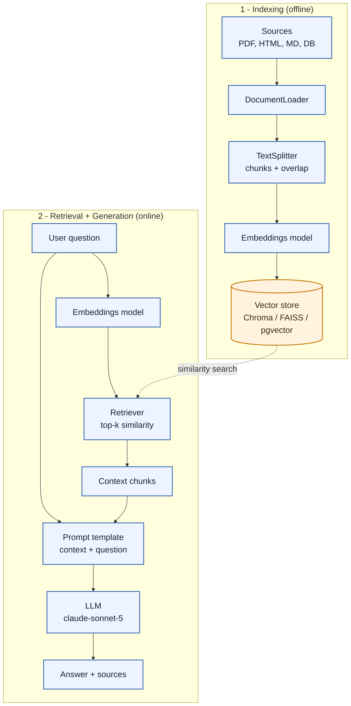
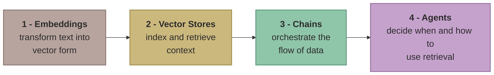

# RAG Solution

## Why we need RAG
Retrieval Augmented Generation = LLM reasoning + external knowledge

for example, if a user ask a question, RAG find first the revelant informations then uses that data to help the model create a responses this make the answer more reliable and based on facts not just what the model learn during training 

1) RAG powers grounded, explainable AI systems 
 Examples
   1) Customer support chatbots using company manuals 
   2) HR assistants answering from policy documents 
   3) Research copilots citing academic papers 
   
2) Key Takeways:
   1) RAG = model reasoning + external evidence 
   2) make the LLMs **reliable**, **current** and **verifiable**

## Anatomy of RAG PIPELINE 
#### From data to intelligence: the RAG Pipeline
RAG connects your knowledge base to an LLM in a structured way 
## Pipeline schema

steps:
1) Documents
2) Chunking
3) Embeddings
4) Vector Store
5) Retriever
6) LLM

###  RAG with LangChain 
LangChain makes RAG Modular, langchain abstracts RAG into reusable building blocks 

| # | Block | Role | LangChain API |
|---|-------|------|---------------|
| 1 | **Embeddings** | Transform text into vector form | `Embeddings` |
| 2 | **Vector Stores** | Index and retrieve context | `VectorStore` |
| 3 | **Chains** | Orchestrate the flow of data | `Runnable` / LCEL |
| 4 | **Agents** | Decide when and how to use retrieval | `AgentExecutor` |

Langchain provide ready made chains:

* **RetrivalQA** : One shot question answering from documents (retrieves relevant content and generate direct answer)
*  **ConverstionalRetrievalChain** : context aware multi-turn chat (allow the model to retain context across multiple turns and deliver a true chat like experience)
  
Both chains manage retrival, context injection and response generation 

#### Integrating RAG with Agents 
Agents can use RAG as tools to: 
* Search company knowledge bases
* Answer HR or product questions 
* Plan multi-step reasoning accross sources 

### Real world Use case 
With Langchain RAG, treams can build:
* **Entreprise search**: systems grounded in internal documents 
* **Contextual chatbots**: powered by live company data 
* **reseaarch copilots** : that summarize and cite sources 

### Key takeaway: 
1) Langchain make RAG pratical and accessible 
2)  it offers pre bult components, flexible customization and integration with your existing systems 
3)  Langchain = plug and play for RAG workflows